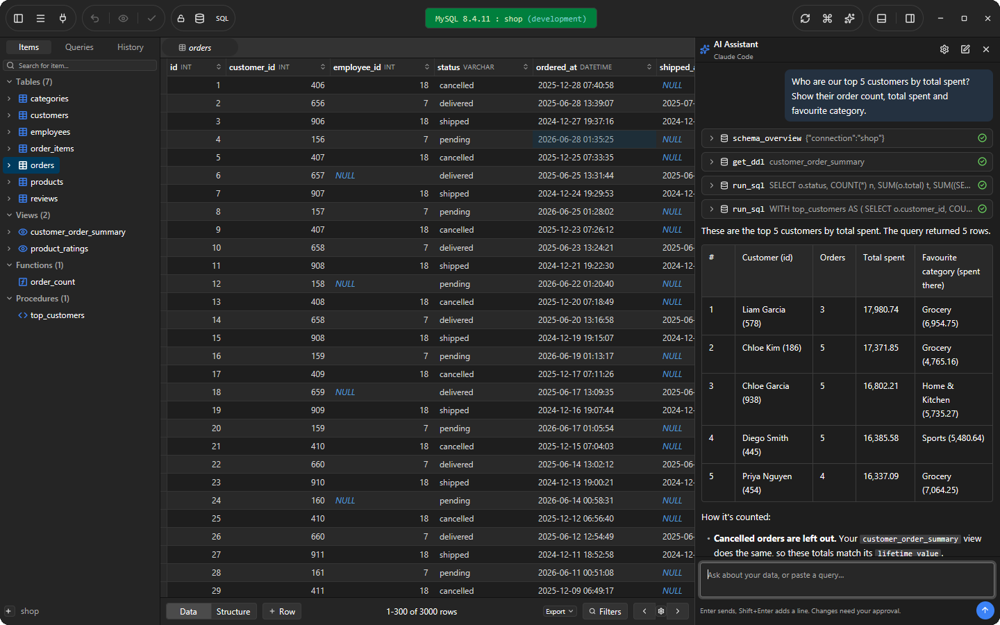
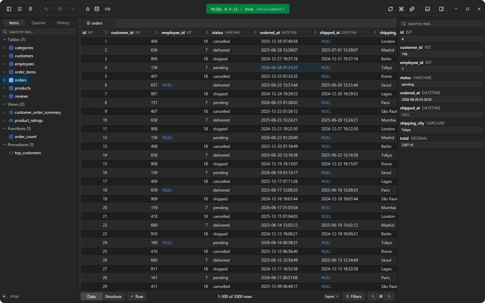
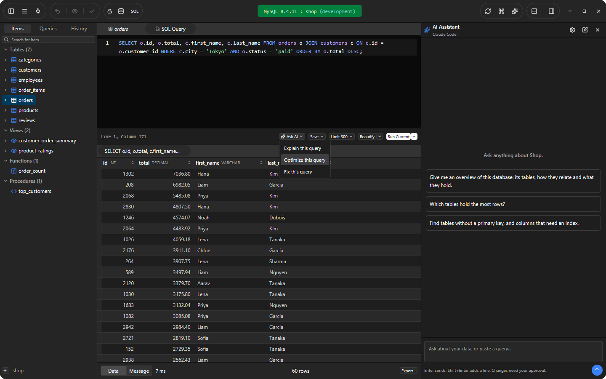
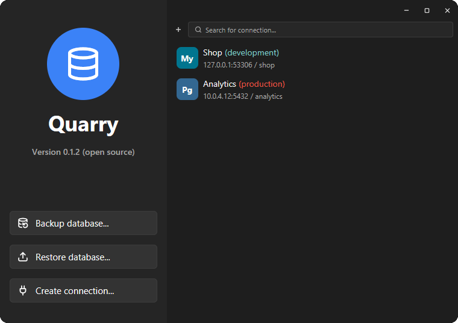
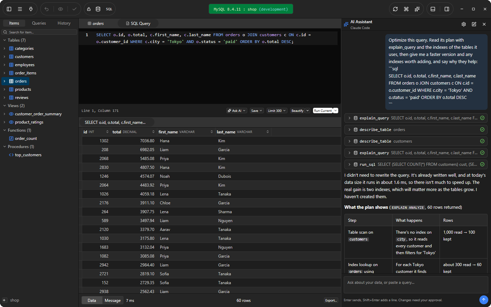
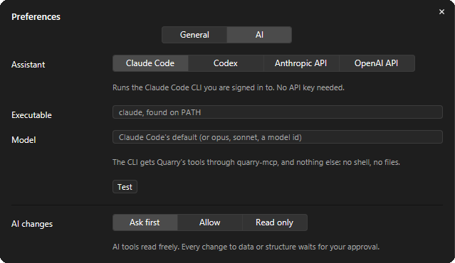
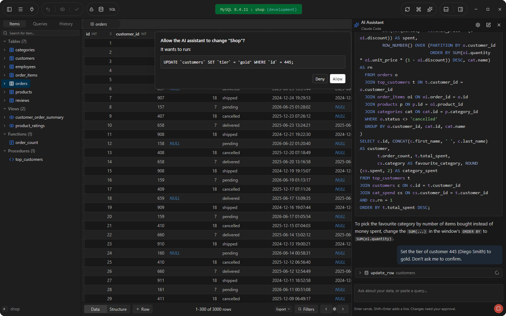
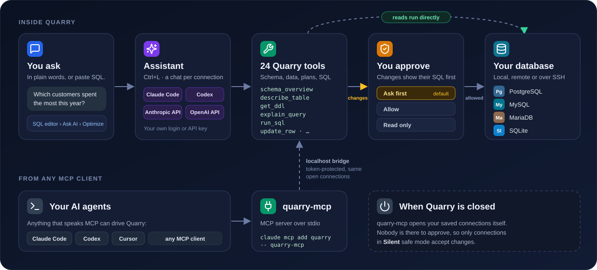
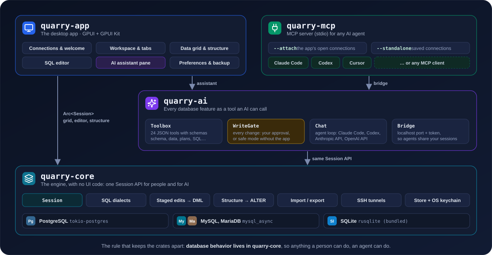

<div align="center">



<p>
  <a href="https://github.com/Dipendra-creator/quarry/releases/latest"></a>
  <a href="https://github.com/Dipendra-creator/quarry/actions/workflows/release.yml"></a>
  <a href="LICENSE"></a>
  
  
  
</p>

<h3>
  <a href="https://github.com/Dipendra-creator/quarry/releases/latest">Download</a>
  <span> · </span>
  <a href="#features">Features</a>
  <span> · </span>
  <a href="#the-ai-assistant">AI assistant</a>
  <span> · </span>
  <a href="#use-quarry-from-any-ai-agent">MCP</a>
  <span> · </span>
  <a href="docs/ARCHITECTURE.md">Architecture</a>
  <span> · </span>
  <a href="#contributing">Contributing</a>
</h3>

</div>

**Quarry** is a native database client for PostgreSQL, MySQL, MariaDB and SQLite, written
in Rust with [GPUI](https://gpui.rs). Its layout, shortcuts and workflows follow
TablePlus for Windows, with no accounts, no license keys and no paywalls. An AI
assistant is built in: it reads your schema before it writes SQL, explains and optimizes
queries from their execution plans, and asks you before it changes anything. The same
tools are available to any AI agent through an MCP server.

<picture>
  <source media="(prefers-color-scheme: dark)" srcset="docs/assets/screenshots/hero-dark.png">
  <source media="(prefers-color-scheme: light)" srcset="docs/assets/screenshots/hero-light.png">
  
</picture>

<p align="center"><sub>A real session on sample data: the assistant read the schema and one of its views, ran two queries, and answered with a table.</sub></p>

## Why Quarry exists

Many developers keep a database client open all day. The best ones are fast and pleasant
to use, but they are usually closed source, tied to an account and limited until you buy
a license. AI models, meanwhile, have become good at SQL. But a chat window does not know
your schema, and an agent holding a raw connection string runs whatever it writes.

Quarry brings both together in one open-source app. You get the familiar
TablePlus-style workflow, and an assistant that works through the same engine as the UI.
Anything you can do in the app, an AI can do through a tool, under your rules.

<table>
  <tr>
    <td align="center" width="25%" valign="top">
      <br>
      <b>Free and open</b><br>
      <sub>No accounts, license keys or paywalls. MIT licensed.</sub>
    </td>
    <td align="center" width="25%" valign="top">
      <br>
      <b>Knows your database</b><br>
      <sub>The assistant reads tables, views, functions and query plans before it answers.</sub>
    </td>
    <td align="center" width="25%" valign="top">
      <br>
      <b>You approve every change</b><br>
      <sub>Reads run freely. A change shows its exact SQL and waits for you.</sub>
    </td>
    <td align="center" width="25%" valign="top">
      <br>
      <b>Native</b><br>
      <sub>Rust and GPUI, the GPU-accelerated UI framework from Zed. No Electron.</sub>
    </td>
  </tr>
</table>

## Download

Get the package for your system from the
[latest release](https://github.com/Dipendra-creator/quarry/releases/latest). Every package
includes the desktop app and the MCP server, and `SHA256SUMS.txt` covers them all.

| Platform | CPU | Packages | Build baseline |
| --- | --- | --- | --- |
| Windows | x64 (Intel/AMD) | Installer EXE, portable ZIP | Windows 10 1809+ |
| Windows | ARM64 | Installer EXE, portable ZIP | Windows 11 |
| macOS | Intel x64 | DMG, zipped Quarry.app | macOS 12+ deployment target; tested on macOS 15 |
| macOS | Apple silicon ARM64 | DMG, zipped Quarry.app | macOS 12+ deployment target; tested on macOS 15 |
| Linux | x64 | DEB, tar.gz | Ubuntu 22.04 / glibc 2.35 |
| Linux | ARM64 | DEB, tar.gz | Ubuntu 22.04 / glibc 2.35 |

> [!NOTE]
> Windows packages are unsigned. macOS builds are ad hoc signed, **not Developer ID signed
> or Apple notarized**, so macOS asks you to confirm the first launch (see below).

<details>
<summary><b>Windows</b></summary>

Run `QuarrySetup-<version>-<arch>.exe`. It installs for the current user without admin
rights, or for all users if you select that. It adds Start menu and optional desktop
shortcuts and an uninstaller. For portable use, extract the ZIP and run `quarry.exe`.
Uninstalling keeps saved connections and passwords.

</details>

<details>
<summary><b>macOS</b></summary>

Open the matching DMG and drag Quarry to Applications, or extract the app ZIP. If macOS
blocks a download you trust, use System Settings → Privacy & Security → Open Anyway
([Apple's instructions](https://support.apple.com/en-us/102445)). The MCP executable is
`/Applications/Quarry.app/Contents/MacOS/quarry-mcp`.

</details>

<details>
<summary><b>Linux</b></summary>

On Ubuntu/Debian-compatible systems, install the matching DEB with apt:

```sh
sudo apt install ./Quarry-<version>-linux-x64.deb
```

Or extract the tarball and run its `quarry` executable. Portable builds use the host's
graphics and TLS libraries; on Ubuntu 22.04, install `libfontconfig1 libfreetype6
libssl3 libvulkan1 libwayland-client0 libx11-xcb1 libxkbcommon-x11-0` if needed. The DEB
declares its shared-library dependencies automatically. A working X11 or Wayland session
and a Vulkan-capable graphics driver are required.

</details>

### Where your data lives

Settings live in `%APPDATA%\Quarry` on Windows, `~/Library/Application Support/Quarry` on
macOS and `~/.config/Quarry` on Linux: `connections.json`, `queries.json`,
`history.jsonl`, `settings.json` and `known_hosts`. Set `QUARRY_CONFIG_DIR` to use another
folder. Passwords and API keys never go into these files. They are stored in Windows
Credential Manager, the macOS Keychain or the Linux kernel keyring, under the service name
`quarry`.

## Try it in two minutes

[`examples/demo.sql`](examples/demo.sql) creates a small, fictional shop in SQLite, so no
database server is needed.

1. Open Quarry, click **Create connection…**, choose **SQLite** and type a path for a new
   file, such as `demo.db`. SQLite creates the file when you connect.
2. Press <kbd>Ctrl</kbd>+<kbd>E</kbd>, paste the contents of `examples/demo.sql`, and run
   it all with <kbd>Ctrl</kbd>+<kbd>Shift</kbd>+<kbd>Enter</kbd>. Refresh the sidebar with
   <kbd>Ctrl</kbd>+<kbd>R</kbd>.
3. Press <kbd>Ctrl</kbd>+<kbd>L</kbd> and ask: *"Which customers haven't ordered in the
   last 60 days?"* The answer is Robin, and Jordan, who has never ordered.
4. Ask it to mark those customers inactive. Quarry shows the `UPDATE` it wants to run and
   waits for you to allow or deny it.

The assistant uses the Claude Code CLI by default. To use Codex, the Anthropic API or the
OpenAI API instead, open Preferences → AI (<kbd>Ctrl</kbd>+<kbd>,</kbd>).

## Features

### Work with your data



- **Data grid** with sorting, paging, a row count, and a filter bar with all 22 operators,
  plus "Any column" and "Raw SQL".
- **Inline editing:** add, duplicate and delete rows, set NULL, and follow foreign keys.
  Changes are staged and colored yellow, green or red until you commit (<kbd>Ctrl</kbd>+<kbd>S</kbd>)
  or discard them, and you can preview their SQL first.
- **Row detail pane** showing every field of the selected row, editable for tables.
- **Structure:** columns, indexes and foreign keys. Adding, editing and dropping columns and
  indexes are staged as `ALTER` statements. Plus a DDL view.
- **Import and export:** export to CSV, JSON or SQL, and import CSV.

### Write SQL



- Syntax highlighting and autocomplete for keywords, tables, columns and `alias.column`.
- Run the statement under the cursor or the selection (<kbd>Ctrl</kbd>+<kbd>Enter</kbd>), or
  everything (<kbd>Ctrl</kbd>+<kbd>Shift</kbd>+<kbd>Enter</kbd>), with an automatic `LIMIT`.
- A result tab per statement, with messages and errors. Export results.
- Beautify and uglify, save to the Queries list or to a `.sql` file, and open `.sql` files.
- **Ask AI** explains, optimizes or fixes the current query in one click.

### Connect anywhere, safely

<p align="center">
  
</p>

- **Connections:** saved connections and groups, search, duplicate, delete, a status
  color, an environment tag, SSL modes and bootstrap commands. Passwords are kept in the OS
  keychain or asked for each time.
- **Over SSH**, with a password or a key, and host-key checking.
- **Five safe-mode levels**, as in the original. Silent sends queries directly. Alert asks
  before sending. Safe requires typing the connection name. The "except read" variants
  skip the prompt for `SELECT`/`SHOW`/`EXPLAIN`.
- **Workspace:** several connections in one window, preview tabs, an Items / Queries /
  History sidebar, a console log, a database switcher (<kbd>Ctrl</kbd>+<kbd>K</kbd>),
  Open Anything (<kbd>Ctrl</kbd>+<kbd>P</kbd>) and a process list (<kbd>Ctrl</kbd>+<kbd>.</kbd>).
- **Everything else:** light and dark themes, and backup and restore (`pg_dump`,
  `mysqldump`, `psql` and `mysql` from your PATH; SQLite built in).

### Supported databases

| Database | Driver | Status |
| --- | --- | --- |
| PostgreSQL | [`tokio-postgres`](https://crates.io/crates/tokio-postgres) | Passes live tests against a real server |
| MySQL | [`mysql_async`](https://crates.io/crates/mysql_async) | Passes live tests against a real server |
| MariaDB | [`mysql_async`](https://crates.io/crates/mysql_async) | Shares the MySQL driver |
| SQLite | [`rusqlite`](https://crates.io/crates/rusqlite), bundled | Passes end-to-end tests |

More are on the [roadmap](#roadmap).

## The AI assistant

Press <kbd>Ctrl</kbd>+<kbd>L</kbd> or click the sparkles button in the title bar. Each
connection gets its own chat, and the assistant works through Quarry's tools. It is told
never to guess table or column names, and to look them up first.



What you can ask it:

- **Questions about your data.** It finds the tables, writes the queries, runs them and
  answers.
- **Complex SQL from a description,** including joins, CTEs, aggregates and window
  functions.
- **Explaining a query** you paste, and pointing out its mistakes.
- **Optimizing a query.** It reads the execution plan (`EXPLAIN`, or `EXPLAIN ANALYZE` for
  read-only queries) and the indexes, then proposes a rewrite or indexes and says why they
  help.
- **Changing data or structure,** if you allow it.

Every SQL block in a reply has buttons to open it in a new editor tab, open and run it, or
copy it.

### Choose your AI

| Backend | How it runs | What you need |
| --- | --- | --- |
| **Claude Code** (default) | The `claude` CLI in headless mode, resuming the chat's session | Claude Code installed and signed in |
| **Codex** | The `codex` CLI in headless mode, resuming the chat's thread | Codex installed and signed in |
| **Anthropic API** | The Messages API, streamed, with tool use | An API key; the default model is `claude-opus-5-5` |
| **OpenAI API** | Chat Completions, streamed, with tool calls | An API key; the endpoint can be any OpenAI-compatible server |

The CLIs get Quarry's tools and nothing else: no shell and no file access. API keys are
stored in the OS keychain, and Quarry falls back to `ANTHROPIC_API_KEY` or `OPENAI_API_KEY`
if no key is saved.

<p align="center">
  
</p>

> [!IMPORTANT]
> The assistant sends your messages, plus what its tools return (schema details and query
> results), to the AI backend you choose. Use a backend you are allowed to share that data
> with.

### You approve every change

Reading is free. Anything that would modify a database (SQL that writes, row edits,
structure edits and imports) passes a gate first. With the default setting, **Ask first**,
Quarry shows the exact statement and waits:



Deny it, or close the dialog, and nothing runs; the model is told the change was refused.
Preferences → AI → **AI changes** offers two other settings:

- **Allow:** changes run without asking, except on connections in an Alert or Safe mode,
  which still ask.
- **Read only:** every change is refused.

`EXPLAIN ANALYZE` of a write statement counts as a write, because it runs the statement.

## Use Quarry from any AI agent

`quarry-mcp`, installed next to the app, is a [Model Context Protocol](https://modelcontextprotocol.io)
server. It gives Claude Code, Codex, Cursor or any other MCP client the same tools the
assistant uses.

```sh
claude mcp add quarry -- "C:\Program Files\Quarry\quarry-mcp.exe"     # Windows install
claude mcp add quarry -- /Applications/Quarry.app/Contents/MacOS/quarry-mcp   # macOS
```

Preferences → AI shows the exact command for your install.



- **While Quarry is open,** `quarry-mcp` attaches to the app through a token-protected
  localhost bridge. Agents work on the connections you have open, and their changes wait
  for your approval in the app. Tools that would close or switch a connection under your
  open tabs are not offered.
- **When Quarry is closed,** it opens your saved connections itself. Nobody is there to
  approve, so only connections in **Silent** safe mode accept changes; every other mode is
  read-only for agents.

<details>
<summary><b>The 24 tools</b></summary>

| Tool | Purpose |
| --- | --- |
| `list_connections` | Saved and open connections, with driver, tag, safe mode and connected state |
| `connect` / `disconnect` | Open or close a connection |
| `save_connection` | Create or update a connection; the password goes to the keychain |
| `list_databases` / `switch_database` | Databases on the server |
| `list_schemas` | Schemas (PostgreSQL) |
| `list_tables` | Tables, views, materialized views, functions, procedures and sequences |
| `describe_table` | Columns, indexes and foreign keys |
| `get_ddl` | The CREATE statement of any item, including views, functions and procedures |
| `schema_overview` | Every table and view with its columns; the best first call |
| `select_rows` | Rows with filters (all data-view operators), sorting and paging |
| `count_rows` | Row count, optionally filtered |
| `search_data` | Find a text in any column of every table |
| `explain_query` | The execution plan; `analyze` adds real timings for read-only queries |
| `run_sql` | Run one or more statements (adds a `LIMIT` to SELECTs that have none) |
| `insert_row` / `update_row` / `delete_rows` | Row edits by primary key, with `dry_run` |
| `alter_table` | Add, drop or modify columns and indexes, with `dry_run` |
| `import_csv` | Insert CSV rows (text or file) in one transaction |
| `query_history` | Recent statements |
| `list_saved_queries` / `save_query` | The Queries tab |

</details>

[docs/AI.md](docs/AI.md) covers the backends, the bridge protocol and the write policy in
detail.

## Architecture



```
crates/quarry-core   UI-free engine: drivers, sessions, SQL generation, staged edits,
                     structure edits, import/export, SSH tunnels, storage
crates/quarry-ai     Tools (JSON schemas), write gate, assistant backends, bridge, quarry-mcp
crates/quarry-app    The GPUI desktop app
docs/                Architecture, AI and release notes
examples/            Sample data for trying Quarry
```

[docs/ARCHITECTURE.md](docs/ARCHITECTURE.md) explains how the pieces fit together and how
to add a database driver.

## Build from source

You need a stable Rust toolchain (edition 2024; tested with 1.98). On Windows, you also
need the MSVC build tools. On Linux, install the libraries GPUI needs: X11/Wayland,
xkbcommon, fontconfig and Vulkan.

```sh
cargo run -p quarry-app --release          # the desktop app
cargo build -p quarry-ai --release         # target/release/quarry-mcp(.exe), the MCP server
cargo test                                 # unit and SQLite end-to-end tests
```

The first build compiles GPUI and takes several minutes.

To build the Windows installer yourself, install [Inno Setup 6](https://jrsoftware.org/isinfo.php)
(`winget install JRSoftware.InnoSetup`) and run:

```powershell
packaging\windows\build-installer.ps1   # → target\dist\installer\QuarrySetup-<version>-x64.exe
```

The installer build links the C runtime statically, so target machines need no Visual
C++ Redistributable. It requires Windows 10 1809 or later.

<details>
<summary><b>Keyboard shortcuts</b></summary>

| Keys | Action |
| --- | --- |
| <kbd>Ctrl</kbd>+<kbd>N</kbd> | Connection list |
| <kbd>Ctrl</kbd>+<kbd>P</kbd> | Open anything (tables, views, functions, saved queries) |
| <kbd>Ctrl</kbd>+<kbd>K</kbd> | Switch database |
| <kbd>Ctrl</kbd>+<kbd>E</kbd> / <kbd>Ctrl</kbd>+<kbd>T</kbd> | New SQL editor tab |
| <kbd>Ctrl</kbd>+<kbd>Enter</kbd> / <kbd>Ctrl</kbd>+<kbd>Shift</kbd>+<kbd>Enter</kbd> | Run current statement or selection / run all |
| <kbd>Ctrl</kbd>+<kbd>S</kbd> | Commit staged changes (in an SQL tab: save to Queries) |
| <kbd>Ctrl</kbd>+<kbd>Shift</kbd>+<kbd>P</kbd> | Preview the SQL of staged changes |
| <kbd>Ctrl</kbd>+<kbd>Shift</kbd>+<kbd>Delete</kbd> | Discard staged changes |
| <kbd>Ctrl</kbd>+<kbd>I</kbd> / <kbd>Ctrl</kbd>+<kbd>D</kbd> / <kbd>Delete</kbd> | Insert row / duplicate row / delete selected row |
| <kbd>Ctrl</kbd>+<kbd>F</kbd> | Filter bar |
| <kbd>Ctrl</kbd>+<kbd>R</kbd> / <kbd>F5</kbd> | Reload |
| <kbd>Ctrl</kbd>+<kbd>Shift</kbd>+<kbd>R</kbd> | Reconnect |
| <kbd>Shift</kbd>+<kbd>F5</kbd> | Disconnect |
| <kbd>Ctrl</kbd>+<kbd>W</kbd>, <kbd>Ctrl</kbd>+<kbd>Tab</kbd>, <kbd>Ctrl</kbd>+<kbd>Shift</kbd>+<kbd>Tab</kbd> | Close, next and previous tab |
| <kbd>Ctrl</kbd>+<kbd>Space</kbd> | Toggle the row detail pane |
| <kbd>Ctrl</kbd>+<kbd>Alt</kbd>+<kbd>C</kbd> | Toggle the console log |
| <kbd>Ctrl</kbd>+<kbd>0</kbd> | Toggle the sidebar |
| <kbd>Ctrl</kbd>+<kbd>.</kbd> | Processes (cancel/kill) |
| <kbd>Ctrl</kbd>+<kbd>L</kbd> | AI assistant |
| <kbd>Ctrl</kbd>+<kbd>O</kbd> / <kbd>Ctrl</kbd>+<kbd>Shift</kbd>+<kbd>S</kbd> | Open a `.sql` file / save the editor to a file |
| <kbd>Ctrl</kbd>+<kbd>,</kbd> | Preferences |

</details>

<details>
<summary><b>Tests</b></summary>

`cargo test` runs the unit tests, the SQLite end-to-end tests, and the AI layer's tests,
including both API backends against a local mock server. The live tests for the server
drivers run only when you point them at real servers:

```sh
docker run -d --rm --name quarry-test-pg -e POSTGRES_PASSWORD=quarry -p 127.0.0.1:55432:5432 postgres:17
docker run -d --rm --name quarry-test-mysql -e MYSQL_ROOT_PASSWORD=quarry -e MYSQL_DATABASE=shop -p 127.0.0.1:53306:3306 mysql:8.4
QUARRY_TEST_PG=127.0.0.1:55432:postgres:quarry \
QUARRY_TEST_MYSQL=127.0.0.1:53306:root:quarry \
cargo test -p quarry-core --test live
```

`QUARRY_TEST_SSH` and `QUARRY_TEST_PG_VIA_SSH` add the SSH tunnel test (see
`crates/quarry-core/tests/live.rs`). The live assistant test runs real model turns, which
can incur provider charges, so it runs only when you name a backend, for example
`QUARRY_TEST_AI=claude_code cargo test -p quarry-ai --test live_assistant` (see
[docs/AI.md](docs/AI.md#tests)).

</details>

<details>
<summary><b>Releasing</b></summary>

The [Release workflow](.github/workflows/release.yml) builds and tests all six desktop
targets on pushes to main. It publishes all packages together when a version tag is pushed.
Update the workspace version in `Cargo.toml`, run `cargo check` to refresh `Cargo.lock`,
and commit the changes before tagging. For example, after updating the version to
`0.1.3`:

```sh
git tag -a v0.1.3 -m "Quarry v0.1.3"
git push origin main
git push origin v0.1.3
```

The workflow checks the tag against the workspace version, runs the unit and SQLite
tests, verifies native executables and MCP startup, and publishes the 12 packages with
SHA-256 checksums only after all six targets pass. A branch run builds without
publishing; a tag run publishes. No extra secrets are required for these unsigned or ad
hoc signed packages. See [docs/RELEASING.md](docs/RELEASING.md) for the native packaging
commands and the signing status.

</details>

## Roadmap

Features TablePlus has that Quarry does not have yet:

- [ ] Drivers: SQL Server, Redis, MongoDB, ClickHouse, DuckDB, CockroachDB, Redshift,
      Greenplum, Vertica, Cassandra, Snowflake, BigQuery, libSQL/Turso, Cloudflare D1,
      DynamoDB, Elasticsearch
- [ ] Metrics board, ER diagram, a chart tab for results, user and privilege management
- [ ] Query parameters and variables, JSON viewer and quick look, map view
- [ ] Create Table and Clone Table dialogs (today: SQL templates from the sidebar "+" menu)
- [ ] Import of SQL dumps and JSON through dialogs (today: open a `.sql` file and run it)
- [ ] Customizable keymap, plugins, more UI languages

## Contributing

Quarry is young, and trying it is the most useful contribution right now.

- **Found a problem?** [Open an issue](https://github.com/Dipendra-creator/quarry/issues)
  with your OS, CPU, Quarry version, database and the steps to reproduce it.
- **Want to send code?** Keep database behavior in `quarry-core`, so the UI and the AI
  share it, and run `cargo test` before opening a pull request. To add a database, follow
  [Adding a driver](docs/ARCHITECTURE.md#adding-a-driver).

## License and acknowledgements

Quarry is released under the [MIT License](LICENSE). It is not affiliated with TablePlus;
it uses its own name and icons, and none of TablePlus's artwork.

Built on [GPUI](https://gpui.rs) by Zed Industries; [GPUI Kit](https://gpui-kit.com) and
GPUI Component by Longbridge; [Lucide](https://lucide.dev) icons; and the
[`tokio-postgres`](https://crates.io/crates/tokio-postgres),
[`mysql_async`](https://crates.io/crates/mysql_async),
[`rusqlite`](https://crates.io/crates/rusqlite) and [`russh`](https://crates.io/crates/russh)
crates.
